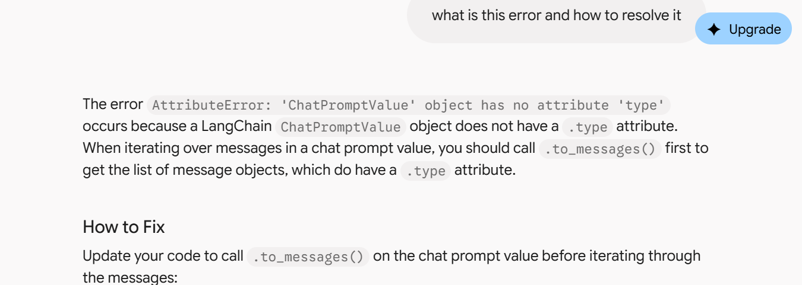

# Change this:
# for message in messages:
#     print(f"{message.type.upper()}:")

# To this:
chat_messages = messages.to_messages()
for message in chat_messages:
    print(f"{message.type.upper()}:")
    print(message.content)
    print()

    ----------------------------

    
